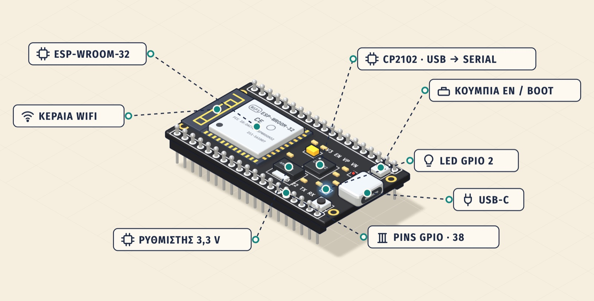
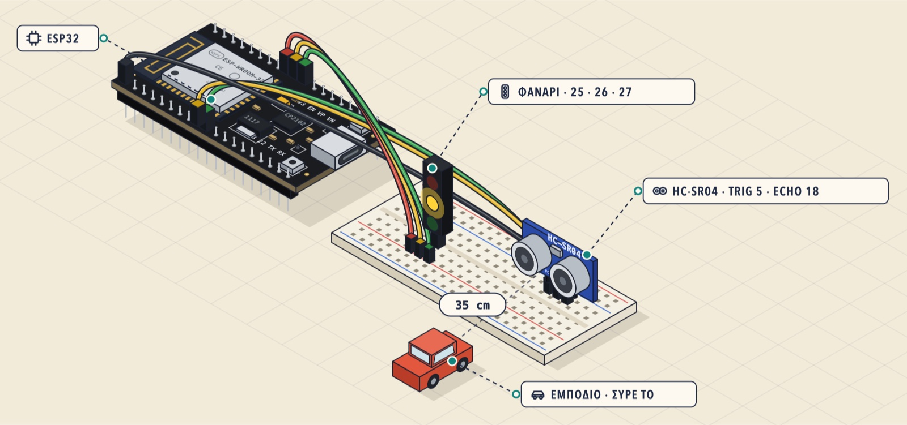
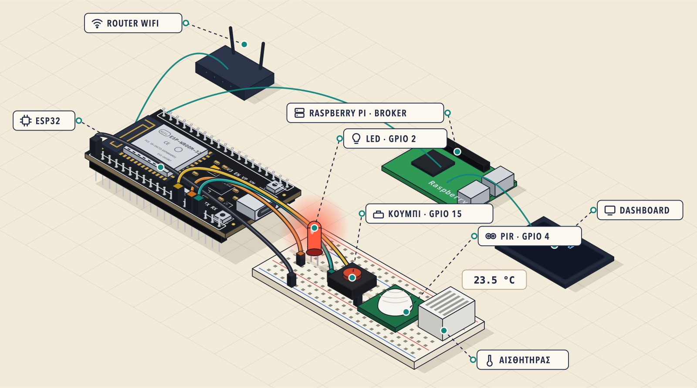
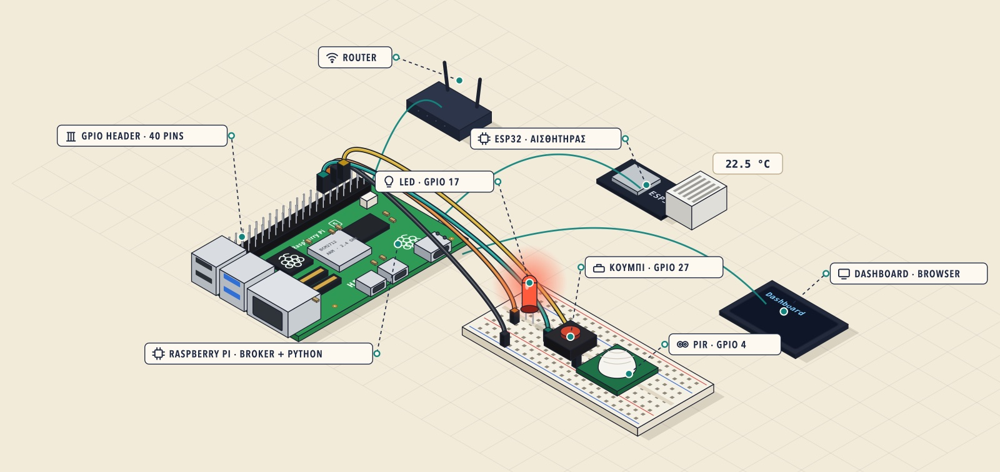
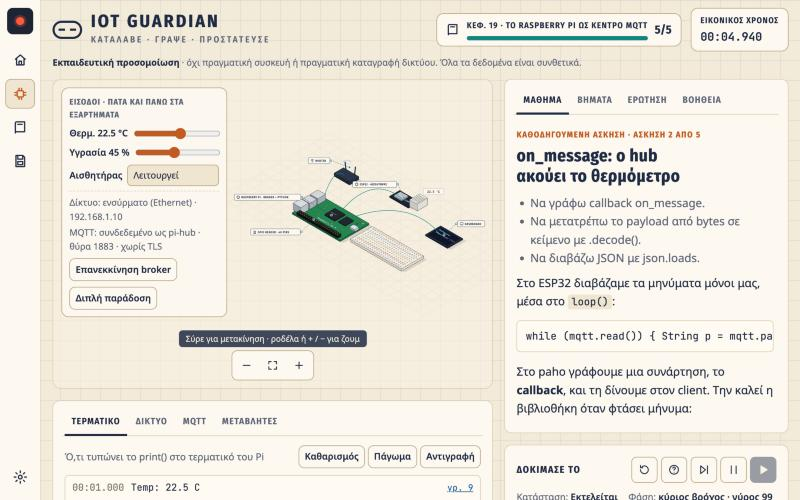
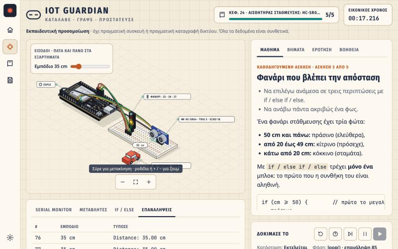
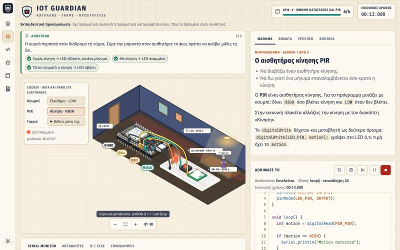
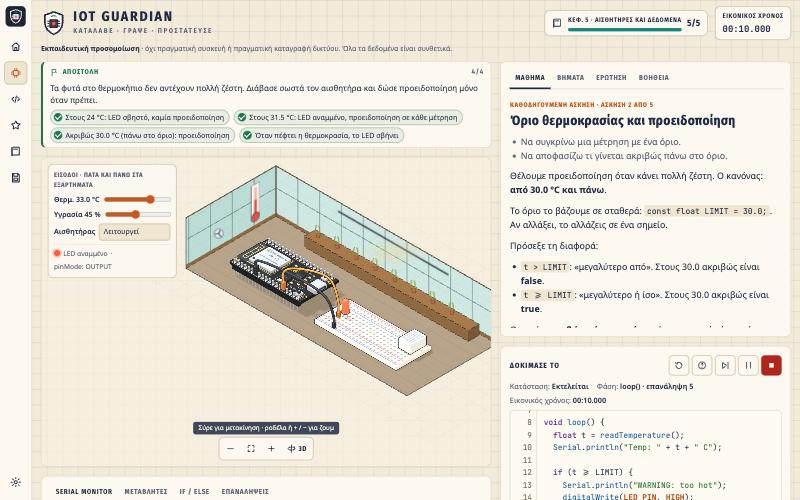
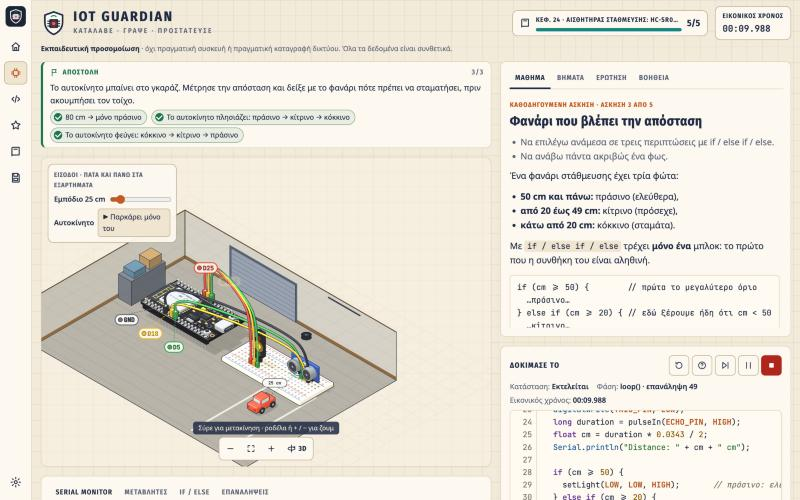

# IoT Guardian

**Παίξε τώρα, χωρίς εγκατάσταση:** https://gyuri1999.github.io/iot-guardian/



Ελληνόφωνη εκπαιδευτική εφαρμογή στον browser: από το πρώτο LED μέχρι ένα ασφαλώς ρυθμισμένο εικονικό έξυπνο σπίτι. Ο μαθητής γράφει κώδικα Arduino-style για μια **εικονική** πλακέτα τύπου ESP32, συνδέει WiFi και MQTT, ρυθμίζει έναν εικονικό broker και αναλύει συνθετική κίνηση δικτύου. Στο Μέρος Β γράφει Python για ένα εικονικό Raspberry Pi: GPIO, κέντρο MQTT, βάση SQLite, web dashboard με Flask και θωράκιση του Pi (SSH, firewall, logs).

> Εκπαιδευτική προσομοίωση — όχι πραγματική συσκευή ή πραγματική καταγραφή δικτύου. Η ασφάλεια διδάσκεται αμυντικά: ο μαθητής ρυθμίζει και ελέγχει μόνο το δικό του εικονικό σύστημα.

## Εικόνες

Ισομετρικός πάγκος εργαστηρίου σε 3D (Three.js: στρογγυλεμένα εξαρτήματα, απαλές σκιές), με κάθε κομμάτι διαδραστικό: πατάς ένα εξάρτημα ή την ετικέτα του και βλέπεις τι είναι, τι κάνει και πώς συνδέεται. Με το κουμπί **3D** η σκηνή γυρίζει γύρω γύρω: σέρνεις για να τη δεις από κάθε πλευρά, ροδέλα για ζουμ, Esc για επιστροφή.

| | |
|---|---|
|  |  |
| **Αισθητήρας στάθμευσης:** σέρνεις το αυτοκίνητο και το φανάρι αλλάζει χρώμα. | **ESP32 και MQTT:** LED, κουμπί, PIR, θερμόμετρο, WiFi, broker, dashboard. |
|  |  |
| **Raspberry Pi με Python:** gpiozero, paho-mqtt, SQLite, Flask. | **Μάθημα σε εξέλιξη:** σκηνή, θεωρία, κώδικας και τερματικό σε μία οθόνη. |



## Θεματικά δωμάτια και αποστολές

Κάθε μάθημα γίνεται μέσα σε έναν χώρο που ταιριάζει με την άσκηση, και ο κώδικάς σου τον «ζωντανεύει».

**Το σπίτι-χάρτης:** η αρχική οθόνη είναι ένα σπίτι σε τομή με τα 8 δωμάτια. Όταν τελειώνεις τα κεφάλαια ενός δωματίου ανάβουν τα φώτα του, μια κόκκινη καρφίτσα δείχνει πού είσαι, και με ένα κλικ ανοίγει η κάρτα του δωματίου με τα κεφάλαιά του.

| Δωμάτιο | Κεφάλαια | Τι κάνει το κύκλωμα |
|---|---|---|
| Γραφείο | πρώτα βήματα (C++, Python, MicroPython, Rust) | το LED ανάβει το φωτιστικό |
| Είσοδος | κουμπί | το κουμπί είναι το κουδούνι: πατάς το κουδούνι στον τοίχο και ακούγεται |
| Διάδρομος τη νύχτα | PIR | σέρνεις τη γιαγιά μπροστά στον αισθητήρα ή την αφήνεις να κάνει βόλτα μόνη της |
| Εργαστήρι | συναρτήσεις, χρόνος | το ρολόι στον τοίχο χτυπά όσο τρέχει ο κώδικας |
| Θερμοκήπιο | θερμοκρασία, MQTT | πατάς το θερμόμετρο για ζέστη ή τον ανεμιστήρα για δροσιά |
| Σαλόνι | WiFi, εντολές, web | λάμπα και τηλεόραση ανάβουν με το LED |
| Δωμάτιο servers | δίκτυο και ασφάλεια | τα λαμπάκια στα racks ανάβουν πράσινα |
| Γκαράζ | στάθμευση | το αυτοκίνητο παρκάρει μόνο του και το φανάρι αλλάζει χρώμα |

- **Αποστολή:** πάνω από τη σκηνή, μια μικρή ιστορία και οι στόχοι της άσκησης, που τσεκάρονται **ζωντανά** όσο γράφεις.
- **Γιορτή:** στο τέλος πέφτουν κομφετί και η αποστολή παίρνει σφραγίδα «Αποστολή εξετελέσθη».
- **Ήχοι:** κλικ, κουδούνι, «τικ» για κάθε στόχο, μελωδία επιτυχίας. Κλείνουν από τις Ρυθμίσεις.
- **Καλώδια που διαβάζονται:** κάθε καλώδιο ταξιδεύει στο δικό του ύψος και μπαίνει κάθετα στην τρύπα του. Ένα ταμπελάκι στο χρώμα του δείχνει από ποιο pin φεύγει (D2, D15, GND…).
- **Ο κώδικας που τρέχει φαίνεται:** φωτίζεται η γραμμή που εκτελείται, με μικρό Serial Monitor και κουμπί διακοπής.

Όλα τα εφέ κίνησης σταματούν με τη ρύθμιση «Μειωμένη κίνηση».

**Με τα χέρια:**
- **Σύνδεσε μόνος σου τα καλώδια:** την πρώτη φορά που βλέπεις ένα εξάρτημα, τα καλώδια λείπουν. Διαλέγεις καλώδιο και πατάς το pin στο σχέδιο της πλακέτας (ESP32 ή header 40 pins του Pi). Σε λάθος pin μαθαίνεις γιατί δεν θα δούλευε: «το GND είναι πάντα 0 V», «το 3V3 έχει πάντα ρεύμα», «το D34 είναι μόνο είσοδος»… Μετά από δύο λάθη φωτίζεται το σωστό pin. Το κουμπί «Καλώδια» στη σκηνή ξαναρχίζει την άσκηση όποτε θέλεις.
- **Λογικός αναλυτής:** νέα καρτέλα κάτω από τη σκηνή. Κάθε pin (LED, κουμπί, PIR, φανάρι, TRIG/ECHO) είναι μια γραμμή HIGH/LOW στον χρόνο, με κουκκίδες εκεί όπου ο κώδικας *διάβασε* μια είσοδο. Πάνω από τη γραμμή βλέπεις τις τιμές και ποια γραμμή κώδικα έκανε την αλλαγή, και με ένα κλικ πας σε αυτήν. Φαίνεται έτσι, για παράδειγμα, η καθυστέρηση που βάζει ένα `delay(500)`.

**Για διάβασμα και μάθηση:**
- **Λέξεις που εξηγούνται:** οι όροι του γλωσσαρίου μέσα στο μάθημα είναι υπογραμμισμένοι. Πατάς και βλέπεις (ή ακούς) τον ορισμό.
- **«Τι κάνει αυτή η γραμμή;»:** κάτω από τον κώδικα, εξήγηση σε απλά ελληνικά για τη γραμμή όπου βρίσκεται ο κέρσορας (C++, Python, Rust).
- **Επανάληψη σε κουτιά:** η ερώτηση κάθε άσκησης που τελείωσες ξανάρχεται αύριο. Αν τη θυμάσαι, ανεβαίνει κουτί και ξαναέρχεται σε 2, 4, 8, 16 μέρες· αν όχι, γυρίζει στο κουτί 1.
- **Στόχος ημέρας και σερί:** 3 ασκήσεις ή σωστές επαναλήψεις τη μέρα, και 🔥 για τις συνεχόμενες μέρες.
- **Σημειώσεις κεφαλαίου:** στόχοι, λέξεις με ορισμούς, κώδικας για να θυμάσαι και τι κατάλαβες, για διάβασμα ή εκτύπωση.

**Για δυσλεξία:**
- **«Άκουσε»:** στο μάθημα, στα βήματα, στην ερώτηση, στη βοήθεια, στην αποστολή, στα σφάλματα και στις κάρτες ιστορίας. Διαβάζει φωναχτά με την ελληνική φωνή της συσκευής (Web Speech API, χωρίς να στέλνει κείμενο πουθενά) και φωτίζει την παράγραφο που ακούγεται. Η ταχύτητα αλλάζει από τις Ρυθμίσεις.
- **Γραμματοσειρά:** Didact Gothic (απλά σχήματα γραμμάτων) ή Ysabeau Infant (στρογγυλά «α» και «g»), και οι δύο με ελληνικά.
- **Χάρακας ανάγνωσης:** μια λωρίδα ακολουθεί τη γραμμή που διαβάζεις, με ή χωρίς σκίαση στο υπόλοιπο κείμενο.
- **Απόσταση γραμμάτων και λέξεων:** κανονική, αυξημένη ή πολύ αυξημένη, μαζί με το μέγεθος γραμμάτων και το διάστιχο που υπήρχαν ήδη.

| | | |
|---|---|---|
|  |  |  |
| **Διάδρομος:** PIR και γιαγιά. | **Θερμοκήπιο:** όριο θερμοκρασίας. | **Γκαράζ:** απόσταση και φανάρι. |

## Γλώσσες και διαδρομές

Στην αρχή διαλέγεις γλώσσα και πλακέτα. Κάθε διαδρομή έχει δικά της κεφάλαια και δική της πρόοδο, και αλλάζεις όποτε θέλεις.

| Γλώσσα | Πλακέτα | Κεφάλαια | Ασκήσεις |
|---|---|---|---|
| C++ (Arduino) | ESP32 | 17 | 77 |
| Python 3 | Raspberry Pi | 7 | 35 |
| MicroPython | ESP32 | 6 | 33 |
| Rust (esp-idf-hal) | ESP32 | 6 | 32 |
| Rust (rppal) | Raspberry Pi | 6 | 32 |

Η Rust τρέχει σε δικό της εκπαιδευτικό interpreter (`js/rsinterp.js`, `js/rsruntime.js`, `js/rslib.js`, `js/rscheck.js`). Δείχνει τα λάθη του rustc (ownership/move, mut, τύποι, `?`, εξαντλητικό `match`) με ελληνική εξήγηση. Η MicroPython (`js/pymicro.js`) προσθέτει `machine`, `network`, `umqtt` και `dht`.

**Κάρτες ιστορίας και σήματα:** κάθε κεφάλαιο που τελειώνεις ξεκλειδώνει μια αληθινή ιστορία από τον κόσμο του κώδικα και των επεξεργαστών (`js/stories.js`, 42 κάρτες), π.χ. η Ada Lovelace, ο σκόρος στο Harvard Mark II, η Ariane 5, το Heartbleed. Όλες μαζεύονται στη «Συλλογή».

## Περιεχόμενο C++ και Python στο Pi: 24 κεφάλαια, 112 ασκήσεις

| # | Κεφάλαιο | Ασκήσεις | Τύπος |
|---|---|---|---|
| 1 | Πρώτο πρόγραμμα | 5 | κώδικας |
| 2 | Μεταβλητές και συνθήκες | 5 | κώδικας |
| 3 | Μνήμη κατάστασης και PIR | 4 | κώδικας |
| 4 | Συναρτήσεις και χρόνος | 5 | κώδικας |
| 5 | Αισθητήρες και δεδομένα | 5 | κώδικας |
| 6 | WiFi και δίκτυα | 4 | κώδικας |
| 7 | MQTT θεμέλια | 4 | κώδικας |
| 8 | Αξιόπιστη επικοινωνία | 4 | κώδικας |
| 9 | Ανάλυση δικτύου | 4 | ανάλυση |
| 10 | Authentication και μυστικά | 4 | ρυθμίσεις, κώδικας |
| 11 | TLS και πιστοποιητικά | 6 | κώδικας, ανάλυση |
| 12 | ACLs και ελάχιστα δικαιώματα | 4 | ρυθμίσεις |
| 13 | Ασφαλής λογική εφαρμογής | 5 | κώδικας |
| 14 | Monitoring και ασφαλής διαμόρφωση | 5 | ανάλυση, ρυθμίσεις |
| 15 | Τελικό έργο | 3 | ρυθμίσεις, κώδικας, audit |
| 16 | Επιπλέον: μπαταρία, light sleep και deep sleep (ανοίγει μετά το 6) | 5 | κώδικας |
| 24 | Επιπλέον: αισθητήρας στάθμευσης με HC-SR04 και φανάρι (ανοίγει μετά το 5) | 5 | κώδικας |
| **Μέρος Β** | **Raspberry Pi και Python** (ανοίγει μετά το 7) | | |
| 17 | Python στο Raspberry Pi: τα βασικά | 5 | Python |
| 18 | GPIO με gpiozero: LED, κουμπί, κίνηση | 5 | Python |
| 19 | Το Raspberry Pi ως κέντρο MQTT (paho-mqtt) | 5 | Python |
| 20 | Κανόνες, ειδοποιήσεις και αξιόπιστα δεδομένα | 5 | Python |
| 21 | Αποθήκευση μετρήσεων με SQLite | 5 | Python |
| 22 | Web dashboard με Flask | 5 | Python |
| 23 | Ασφάλεια του Raspberry Pi: SSH, firewall, logs | 5 | ρυθμίσεις, ανάλυση |

Τρεις τύποι άσκησης:
- **Κώδικας:** εκτέλεση, παύση και βήμα-βήμα. Ο μαθητής βλέπει Serial Monitor, μεταβλητές, εξήγηση if/else, πίνακα επαναλήψεων, MQTT inspector με dashboard και Network Monitor.
- **Ρυθμίσεις broker:** υποσύνολο τύπου mosquitto, με ζωντανή εξήγηση του τι επιτρέπεται.
- **Ανάλυση:** φίλτρα στον Network Monitor ή στο log του broker. Ο μαθητής επιλέγει τις γραμμές-τεκμήρια και εξηγεί τι αποδεικνύουν.

Κάθε άσκηση έχει στόχο, θεωρία, βήματα, ερώτηση πρόβλεψης ή κατανόησης, 3 βαθμίδες βοήθειας και έλεγχο με σενάρια συμπεριφοράς. Στο τέλος εμφανίζεται βεβαίωση **εκπαιδευτικής** ολοκλήρωσης, όχι επαγγελματική πιστοποίηση.

## Εκκίνηση

Δεν χρειάζεται εγκατάσταση ή build. Τα scripts είναι απλά (όχι ES modules), οπότε το `index.html` ανοίγει και με διπλό κλικ. Με τοπικό server:

```bash
python3 -m http.server 8000
```

και άνοιγμα του `http://localhost:8000`.

## Αληθινό ESP32 και αληθινός broker (προαιρετικό)

Ο ίδιος κώδικας φλασάρεται σε αληθινό ESP32 και τα μηνύματα περνούν από αληθινό Mosquitto στον υπολογιστή σου. Τρέξε μία φορά το `node real-lab/helper.js --setup` και μετά το `node real-lab/helper.js`. Άνοιξε το `http://localhost:8787`. Οδηγίες και συνδεσμολογία υπάρχουν στο [real-lab/README.md](real-lab/README.md).

## Tests

```bash
node tests/run-tests.js
node tests/run-tests.js --only c7
```

694 tests. Ελέγχουν:
- parser, μη υποστηριζόμενη σύνταξη, χρονισμό, όριο βημάτων, βήμα-βήμα εκτέλεση;
- δίκτυο: topics και wildcards, ACL, retained, TLS και πιστοποιητικά, φίλτρα, JSON, WiFi, αισθητήρα;
- αποθήκευση.

Για κάθε άσκηση ελέγχουν επίσης ότι η λύση περνά, ότι ο αρχικός κώδικας αποτυγχάνει, και ότι κάθε καταγραφή ανάλυσης περιέχει τα τεκμήρια.

## Οργάνωση

| Αρχείο | Ρόλος |
|---|---|
| `js/interpreter.js` | tokenizer → AST → στατικός έλεγχος → εκτέλεση με generator (χωρίς `eval`) |
| `js/pyinterp.js` | το ίδιο για υποσύνολο της Python: εσοχές, f-strings, εξαιρέσεις, `json`, `time`, `gpiozero`, μοντέλο `paho-mqtt` 2.x |
| `js/pyweb.js` | `sqlite3` (μικρή μηχανή SQL), `flask` (εικονικός web server), `markupsafe` |
| `js/pisys.js` | εικονικό σύστημα του Pi: `sshd_config`, `ufw`, `auth.log` |
| `js/device.js` | εικονική πλακέτα: GPIO, Serial, αισθητήρας, WiFi, client MQTT |
| `js/network.js` | εικονικός broker MQTT (ACL, retained, TLS, πιστοποιητικά, log), συνθετικά πακέτα, φίλτρα |
| `js/validator.js` | εκτέλεση σεναρίων ελέγχου, καταγραφές ανάλυσης |
| `js/lessons.js` | κεφάλαια 1–3, λίστα κεφαλαίων, δεξιότητες, γλωσσάρι |
| `js/lessons/chNN.js` | κεφάλαια 4–15 |
| `js/storage.js` | πρόοδος στο localStorage, εξαγωγή/εισαγωγή |
| `js/ui.js` | διεπαφή |
| `js/scene.js` | ισομετρική σκηνή εργαστηρίου |
| `js/scene3d.js` | 3D απόδοση των εξαρτημάτων με Three.js (χωρίς WebGL μένει η SVG σκηνή) |
| `js/themes.js` | θεματικά δωμάτια ανά κεφάλαιο, πατήσιμα αντικείμενα, η γιαγιά του διαδρόμου |
| `js/sfx.js` | μικροί ήχοι με Web Audio (χωρίς αρχεία ήχου) |
| `js/housemap.js` | το σπίτι-χάρτης της αρχικής: τα 8 δωμάτια με την πρόοδο της διαδρομής |
| `js/learn.js` | εργαλεία μάθησης: γλωσσάρι μέσα στο κείμενο, «τι κάνει αυτή η γραμμή», επανάληψη σε κουτιά, σημειώσεις κεφαλαίου |
| `js/wiring.js` | «Σύνδεσε μόνος σου τα καλώδια»: έλεγχος κάθε pin και εξήγηση γιατί ένα λάθος pin δεν θα δούλευε |
| `js/speak.js` | ανάγνωση φωναχτά με την ελληνική φωνή της συσκευής, παράγραφο-παράγραφο |
| `js/vendor/three.min.js` | Three.js r149 (MIT, © three.js authors) |
| `js/real.js` | πάνελ αληθινού ESP32 και μικρός MQTT client πάνω από WebSocket |
| `real-lab/` | τοπικός βοηθός (compile/upload, Serial, Mosquitto) και `IoTGuardian.h` |
| `tools/real-compile.js` | compile όλων των λύσεων για αληθινό ESP32 |
| `docs/AUTHORING.md` | **οδηγός προσθήκης μαθημάτων**: πεδία, υποστηριζόμενη γλώσσα και εντολές, σύνταξη ρυθμίσεων, βήματα και έλεγχοι |
| `tools/write-html.js` | ξαναγράφει τα `index.html` / `iot-guardian.html` όταν προσθέτεις αρχείο μαθημάτων |

## Γνωστοί περιορισμοί

- Το εικονικό ESP32 είναι γενικό μοντέλο. Τα GPIO διαφέρουν μεταξύ πραγματικών πλακετών.
- Η Python είναι εκπαιδευτικό υποσύνολο: δεν υπάρχουν `class`, `lambda`, `with`, αρχεία και `input()`. Τα callbacks του paho και του gpiozero τρέχουν στις αναμονές (`time.sleep`, `loop_forever`, `pause`), όχι σε πραγματικά threads.
- Ο κώδικας είναι εκπαιδευτικό υποσύνολο C++: δεν υπάρχουν `switch`, `break`, πίνακες, `char` ή μέθοδοι σε String. Τα `jsonValid`/`jsonGet` είναι εκπαιδευτικοί βοηθοί, όχι ArduinoJson.
- Το TLS είναι μοντέλο: δεν γίνεται πραγματική κρυπτογράφηση. Τα προβλήματα πιστοποιητικών είναι μεταδεδομένα. Ως σημερινή εικονική ημερομηνία χρησιμοποιείται η 2026-10-15.
- Οι κωδικοί στις ρυθμίσεις είναι φανταστικοί και γράφονται ως απλό κείμενο. Στο mosquitto αποθηκεύονται hashed.
- Το `acl_default` δεν υπάρχει στο mosquitto. Με `acl_default allow` απενεργοποιούνται όλοι οι κανόνες.
- Το `allow_anonymous` ισχύει για όλο τον broker, όχι ανά θύρα. Ο broker δεν δένει τα στοιχεία σύνδεσης σε συγκεκριμένη συσκευή.
- Τα εισερχόμενα μηνύματα της συσκευής δεν δείχνουν flags retained ή DUP. Η διπλή παράδοση αντιμετωπίζεται με `id` στο payload. Η συσκευή στέλνει πάντα με QoS 0.
- Το μοντέλο ενέργειας χρησιμοποιεί ενδεικτικές τιμές του τσιπ ESP32 (WiFi 120 mA, ξύπνιο 40 mA, light sleep 0,8 mA, deep sleep 0,01 mA). Ο ύπνος κλείνει το WiFi. Το ext0 δέχεται εδώ μόνο PIR_PIN και BUTTON_PIN.
- Δεν υπάρχει εξαγωγή αρχείων PCAP για το πραγματικό Wireshark. Το σημείο αυτό είναι προαιρετική Φάση Δ στις προδιαγραφές.

## Άδεια και συνεισφορά

- Κώδικας: **MIT** (`LICENSE`).
- Περιλαμβάνει το [Three.js](https://threejs.org) r149 (`js/vendor/three.min.js`), με άδεια MIT.
- Μαθήματα και εκπαιδευτικό περιεχόμενο: **CC BY-SA 4.0** (`LICENSE-CONTENT.md`).

Διορθώσεις, νέα μαθήματα και μεταφράσεις είναι ευπρόσδεκτα. Για νέο κεφάλαιο διάβασε πρώτα το `docs/AUTHORING.md` και τρέξε `node tests/run-tests.js` πριν από το pull request.

Η πρόοδος αποθηκεύεται μόνο στον browser σου (localStorage). Το παιχνίδι δεν στέλνει δεδομένα πουθενά.
